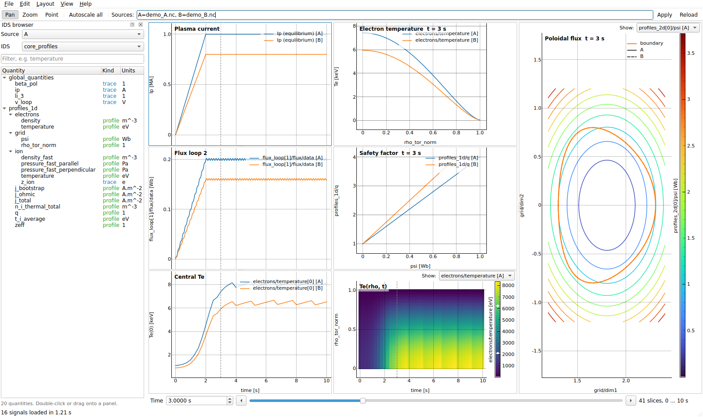
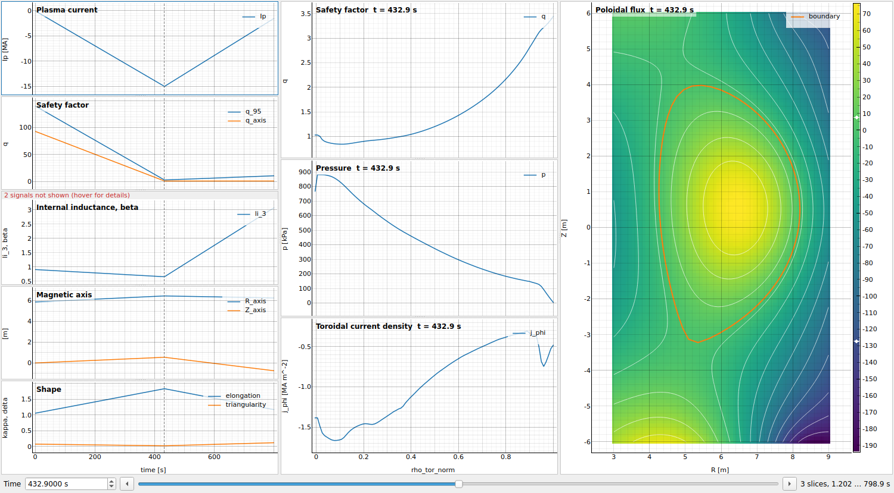
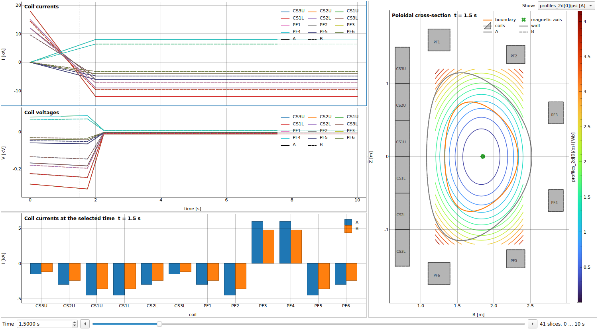
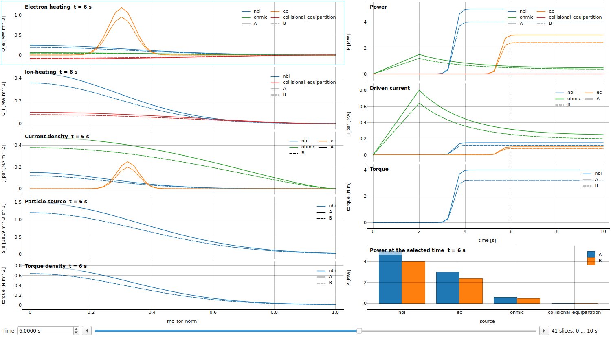
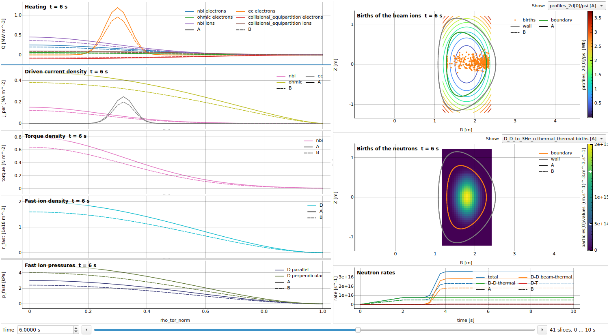
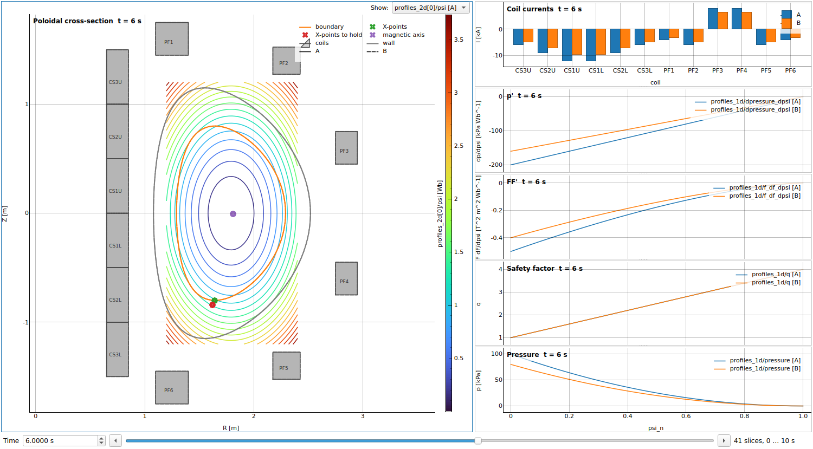
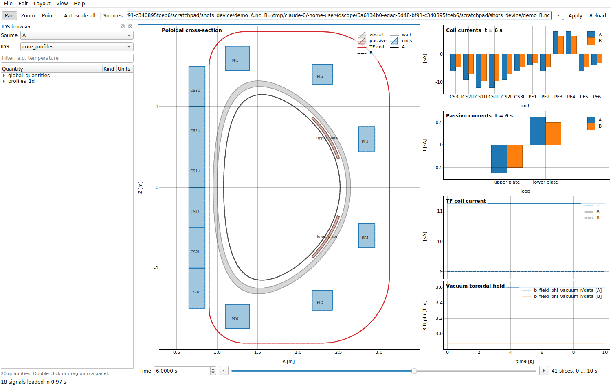

# idscope

[](https://github.com/icyspirit/idscope/actions/workflows/tests.yml)

A lightweight [jScope](https://www.mdsplus.org/index.php/Documentation:Tutorial:GUIs:jScope)-like
viewer for [IMAS](https://imas.iter.org) IDS data. It reads data with
[imas-python](https://github.com/iterorganization/IMAS-Python) and draws it with
[pyqtgraph](https://www.pyqtgraph.org):

- a grid of panels (columns × rows) with time traces, profiles and 2D maps, stacked
  tightly on shared x axes as in jScope,
- a time cursor: profiles and maps follow the time picked on a trace or on the time bar,
- several data sources overlaid in every panel, like shots in jScope,
- wildcards over arrays of structures: every coil, channel or ion species at once,
- coils, walls, plasma boundaries and particle births drawn in the poloidal (R, Z)
  plane,
- an IDS browser that lists the quantities filled in a source,
- configurations saved as YAML, which can be applied to other data,
- the last session back when idscope starts again: panels, sources and time,
- templates for `core_profiles`, `core_sources`, `equilibrium` and `pf_active`, and
  for the results of neutral beam codes (`nbi`) and free-boundary equilibrium solvers
  (`free_boundary`).



## Installation

```bash
git clone https://github.com/icyspirit/idscope.git
cd idscope
pip install -e ".[qt]"
```

`[qt]` installs PySide6. idscope works with any Qt binding supported by pyqtgraph,
so on systems where PySide6 wheels are not available use `pip install -e . PyQt5`
instead (or a Qt binding from your environment modules).

imas-python ≥ 2.3 installs the IMAS Access Layer core (`imas-core`) from PyPI, which
reads HDF5 data entries. netCDF files are read by imas-python itself. Other backends
(MDSplus, UDA) need an IMAS-Core installation that includes them, e.g. from your
site's environment modules.

## Quick start

```bash
python -m idscope.demo demo/      # writes demo_A.nc, demo_B.nc and demo.yaml
idscope demo/demo.yaml
```

Other ways to start:

```bash
idscope                                      # continue the last session
idscope shot.nc                              # the panels of the last session, other data
idscope --new shot.nc                        # browse a netCDF file in an empty panel
idscope -T equilibrium a.nc b.nc             # compare two sources with a template
idscope scope.yaml                           # open a configuration
idscope scope.yaml -s A=a.nc -s "ref=imas:hdf5?path=/data/entry"
                                             # same configuration, other data
idscope scope.yaml -t 12.5 -e scope.png      # save an image at t = 12.5 s, no window
idscope --list shot.nc                       # list the IDSs of a source
idscope --list shot.nc core_profiles         # list the quantities of an IDS
```

## Templates

Templates are ready-made configurations for common IDSs, and for the results of
some kinds of codes. Start from one with `idscope -T NAME SOURCE ...` or File → New
from template; `idscope --list-templates` prints their names. Templates for the
results of a kind of code also go by the names of such codes: `-T nubdec` (NuBDeC)
is `nbi`, `-T sonamu` and `-T freegs` (SONAMU, FreeGS) are `free_boundary`, and
`-T autofrd` (autofrd, which draws a machine) is `device`.

| template | shows |
|---|---|
| `core_profiles` | Ip, central Te/Ti/ne, loop voltage, li and beta over time; Te/Ti, ne/ni, q, current densities and Zeff profiles; Te and ne against (t, x) |
| `core_sources` | for every source (beams, waves, ohmic, ...): profiles of electron and ion heating, current density, particles and torque density; power, driven current and torque over time; the power at the selected time, as bars |
| `device` (`autofrd`) | the machine in the poloidal plane: the vacuum vessel (its layers, between their inner and outer contours), the wall (including parts only at some toroidal angles, such as ports), the passive conductors, the PF coils and the central solenoid, and the conductor of the TF coils; the currents of the coils and passive conductors, and the vacuum toroidal field, when the source has them |
| `equilibrium` | profiles: q, pressure, current densities (j_phi, j_parallel), dp/dpsi, FF', elongation and triangularities |
| `free_boundary` (`sonamu`, `freegs`) | the poloidal plane: flux surfaces, plasma boundary, X-points and those the solver was asked to hold, magnetic axis, coils and wall; the coil currents, as bars; p', FF', q and pressure against psi_n |
| `nbi` (`nubdec`) | what the beams give the plasma: profiles of electron and ion heating, driven current and torque densities; fast ion density and pressures; where the ions of the beams are born (markers) and where the neutrons are (a map per reaction), in the poloidal plane; the neutron rates over time, D-D beam-thermal and thermal apart |
| `pf_active` | current and voltage of every coil over time; the coil currents at the selected time, as bars; the coils in the poloidal plane, with the flux surfaces, the plasma boundary, the magnetic axis and the wall |

Profiles are drawn against rho_tor_norm or, when it is not filled, against the
normalized poloidal flux psi_n (`psi_norm` if filled, otherwise `norm(psi)`, see
below). The templates work with Data Dictionary 3 and 4 data thanks to alternative
paths. Panels whose quantities are not filled in a source say so, e.g. the coil
voltages of a pf_active written by an equilibrium code, which only has currents, or
the totals of a core_sources written by a beam deposition code, which only has
profiles. The output of a beam code has no equilibrium and no wall: to draw the
births over the flux surfaces, give the data entry the code was run on as a second
source. A machine description has the geometry and no currents; given the outputs
of several runs of autofrd, the `device` template draws each machine with a line
style of its own.
A template saved with File → Save as becomes a configuration that can be edited.













## Using the scope

| jScope | idscope |
|---|---|
| Shot field + Apply | **Sources** field + Apply: comma-separated sources, optionally `label=source` |
| Expression (TDI) | Signal **path**, e.g. `equilibrium/time_slice/global_quantities/ip`, with scale and offset |
| Browse signals | **IDS browser** (left): double-click or drag a quantity onto a panel |
| Wave setup (double-click) | **Setup** dialog: double-click a panel (or Enter) |
| Zoom / Point / Pan modes | **Pan** (default) / **Zoom** / **Point** in the toolbar (P, Z, C) |
| Save / Load settings (`.jscp`) | File → Save / Open (YAML); the last session comes back by itself |

- **Sources** are IDS netCDF files (`shot.nc`), IMAS URIs
  (`imas:hdf5?path=/data/entry`, `imas:mdsplus?...`) or HDF5 entry directories.
  Relative paths are relative to the configuration file. The ▾ button next to the
  field (or ↓ in it) lists the recent ones. Files and entry directories dropped on
  the window are added to the sources; a configuration file (`.yaml`) dropped on it
  is opened.
- **Pan** (the default): drag to move; right-drag scales the axes, the wheel zooms.
  **Zoom**: drag a rectangle. **Point**: click or drag in a time trace to set the
  time; the status bar shows the values of the current panel at that time.
- The **time bar** at the bottom steps through the time slices of the profiles and
  maps (also with the keys, see below). The dashed line in time traces can be
  dragged.
- Panels that show the same x quantity **share their x axis** (View → Share x axes):
  time across the window, a profile coordinate within a column. Stacked panels that
  share their x axis are drawn without gaps, and only the lowest shows the x values.
- Right-click a panel for its menu: setup, autoscale, add/remove panels and columns,
  and pyqtgraph's *Export…* (PNG, SVG, CSV of the curves).
- **Delete** or **Backspace** deletes the signals of the current panel, and in a panel
  without signals the panel itself. In the setup dialog, they delete the selected
  signals. Text fields keep these keys for their text.
- **Undo** (Ctrl+Z) and **Redo** (Ctrl+Shift+Z) in the Edit menu take back changes of
  the panels (layout, signals, setup, sizes, shared x axes) and of the sources, and
  the scopes replaced by Open, New or a template. The time is not undone.
- Signals that cannot be shown are reported in red in the panel (hover for details)
  and in View → Log. What a source does not have (an IDS, or a quantity that is not
  filled) is only noted, in gray on the title line of the panel, since sources often
  hold different IDSs: the output of a code and the entry it was run on, for one.
- The IDS browser asks the data entry which quantities are filled. Access Layers
  older than 5.7, and backends such as MDSplus and UDA, cannot tell: the browser then
  reads the data instead. Of long arrays of structures it reads only some elements
  (three time slices; sixteen coils, channels, ...), so a quantity filled in none of
  those is not listed, but can still be typed as a path.

### Keyboard shortcuts

Help → Keyboard shortcuts (F1) lists them. The single keys work on the panels, once
one of them has the keyboard (click on it); text fields and the IDS browser keep the
keys they use.

| on the panels | |
|---|---|
| ↑ ↓ ← → | select the panel above, below, on the left or on the right (in the next column, the closest in height) |
| , . | previous, next time slice |
| P Z C | Pan, Zoom, Point mode |
| A, Shift+A | autoscale the current panel, all panels |
| Enter | setup of the current panel |
| [ ] | previous, next image of the current panel (*Show*) |
| Delete, Backspace | delete the signals of the current panel, then the empty panel |

| anywhere | |
|---|---|
| Ctrl+← Ctrl+→, Ctrl+Home Ctrl+End | previous, next, first, last time slice |
| Ctrl+L, Ctrl+F, Ctrl+T | go to the sources, the filter of the IDS browser, the time |
| ↓ in the Sources field | the recent sources |
| Esc | back to the panels |
| Ctrl+Shift+↓, Ctrl+Shift+→ | add a panel below the current one, add a column |
| Ctrl+Z, Ctrl+Shift+Z (Ctrl+Y) | undo, redo |
| Ctrl+N, Ctrl+O, Ctrl+S, Ctrl+Shift+S | new, open, save, save as |
| Ctrl+E, Ctrl+Q | export an image, quit |
| Ctrl+B, F5, F11, F1 | IDS browser, reload the data, full screen, this list |

On macOS, Ctrl is Cmd.

## Sessions

idscope keeps the scope of the last session: its panels, sources, sizes and time.
Started without a configuration file or a template, it shows them again.

| command | panels | sources |
|---|---|---|
| `idscope` | of the last session | of the last session |
| `idscope shot.nc` | of the last session | `shot.nc` |
| `idscope --new shot.nc` | one empty panel | `shot.nc` |
| `idscope scope.yaml [shot.nc]` | of `scope.yaml` | of `scope.yaml`, or `shot.nc` |
| `idscope -T NAME shot.nc` | of the template | `shot.nc` |

Nothing is lost when idscope closes, so it does not ask to save. Instead, the title
shows `*` while the panels differ from the configuration file (the sources and the
time do not count), and File → Save writes them to it. File →
Open recent lists the configuration files opened or saved last. idscope also keeps
the size of its window, its docks, the mouse mode and the IDS shown in the browser.
An export (`-e`) shows the same panels as the window would, and leaves the session
as it is.

The session (`session.yaml`, a configuration that can also be opened as one) and the
settings (`settings.ini`) are in `~/.config/idscope`, or `%APPDATA%\idscope` on
Windows, or `$IDSCOPE_CONFIG_DIR` if set.

## Signal paths

A path names an IDS and a quantity inside it:

```text
core_profiles/profiles_1d/electrons/temperature      profile vs rho_tor_norm, per time slice
equilibrium/time_slice/global_quantities/ip          time trace
summary/global_quantities/ip/value                   time trace
magnetics/flux_loop[0]/flux/data                     time trace (0-based index)
magnetics/flux_loop(1)/flux/data                     the same, Fortran-style 1-based index
core_profiles/profiles_1d/electrons/temperature[0]   time trace of the first grid point
core_profiles/profiles_1d[3]/electrons/temperature   profile of time slice 3 only
core_profiles/profiles_1d[-1]/electrons/temperature  profile of the last time slice
equilibrium/time_slice/profiles_2d[0]/psi            2D map, per time slice
equilibrium/time_slice/profiles_2d[0]/psi[:, 40]     psi along R at the 41st Z, per time slice
equilibrium:1/time_slice/global_quantities/ip        occurrence 1 of the IDS
norm(equilibrium/time_slice/profiles_1d/psi)         psi normalized per time slice: psi_n
pf_active/coil[:]/current/data                       a time trace per coil
pf_active/coil[0:6]/current/data                     the first six coils (Fortran: coil(1:6))
pf_active/coil[:]/current/data[0]                    the first current sample of every coil
core_profiles/profiles_1d/ion[:]/temperature         a profile per ion species
core_profiles/profiles_1d/ion[:]/temperature[0]      the central temperature of every species
pf_active/coil[:]/element[:]/geometry                the coils in (R, Z)
wall/description_2d[0]/limiter/unit[:]/outline       the wall in (R, Z)
equilibrium/time_slice/boundary/outline              the plasma boundary in (R, Z), per time slice
equilibrium/time_slice/global_quantities/magnetic_axis   the magnetic axis, a point per time slice
distribution_sources/source[:]/markers               where the particles of every source are born
distribution_sources/source[:]/ggd/particles[0]/values   a map per source, on a grid of R by Z
```

- The time-dependent array of structures (`profiles_1d`, `time_slice`, ...) is left
  without index; it becomes the time axis (`[:]`, `(:)` and `(itime)` as in the Data
  Dictionary documentation are accepted too). An index selects one time slice, a
  range some.
- Other arrays of structures need an index: `ion[0]`, `flux_loop(1)`, `coil[-1]`
  (the last one), or a **wildcard**: `:` for all elements, `a:b` or `a:b:step`
  for some of them (Fortran ranges `(a:b)` include both ends). A path with wildcards
  has a member per element, named after its `name` (or `label`, `identifier`, or
  the process of a distribution source, e.g. `D_D_to_3He_n beam_thermal`): a
  curve per coil in time traces, a bar per coil at the selected time in a profile
  panel. Elements with the same name are told apart as `nbi`, `nbi#2`, and a member
  has the same color in all the panels of the window. Wildcards can be nested
  (`coil[:]/element[:]`).
- An index applies to the node it is written on. On the data node it selects numpy
  style along the dimensions of the data, for every element of the wildcards: so
  `coil[:]/current/data[2]` is the third current sample of every coil (a bar per
  coil), `profiles_1d/ion[:]/temperature[0]` the central temperature of every ion
  species over time, and `profiles_2d[0]/psi[:, 40]` a column of the map. Which
  coils or species is written on the array of structures: `coil[0:6]`, `ion[1]`.
- **Dimensions** keep the order of the Data Dictionary coordinates, which the tooltip
  of the IDS browser shows (e.g. `psi`: `grid/dim1, grid/dim2`, and
  `bolometer/power_density/data`: `grid/dim1, grid/dim2, time`). An index selects
  along them in that order, and a map draws the first along x and the second along
  y. idscope never reorders them by itself: `transpose(path, axes...)` does, as
  `numpy.transpose` does on the data left by the index. `transpose(path, 1, 0, 2)`
  puts the second dimension first; without axes the order is reversed (`2, 1, 0`
  for three dimensions), which swaps the two dimensions of a map. Time is a
  dimension like the others: one dimension left makes a curve along its coordinate
  (a time trace when that is time), two make a map (`power_density/data[:, 4]` has
  dim1 along x and time along y), and more need an index
  (`power_density/data[:, :, 2]`). What follows the time bar is the data of the
  time-dependent arrays of structures (`profiles_1d`, `time_slice`, ...).
- A path to a structure that describes a shape draws it in the poloidal plane, over
  maps: the 2D geometry of coils and passive loops (outline, rectangle,
  parallelogram, arcs of circle, annulus or thick line), `r`/`z` outlines,
  `r`/`z` points, and the markers of a particle distribution, as dots (the columns
  of their `positions` that their `coordinate_identifier` says are R and Z). Also
  the layers of a vessel (`wall/description_2d[0]/vessel/unit[:]/annular`), filled
  between their inner and outer contours, or around their centreline as thick as
  their `thickness`; and conductors made of line segments, arcs of circle and full
  circles (`tf/coil[:]/conductor[:]/elements`), drawn at their distance from the
  axis and their height, since their points are in three dimensions. The IDS
  browser lists them as *shape*.
- The `values` of a GGD quantity on a structured grid (grid identifier
  `structured_spaces`: two spaces of one dimension, e.g. R and Z) are a map, on the
  nodes of the grid (the first space running fastest) or on its cells. Values on
  other grids are drawn along their index.
- The x axis and the time come from the Data Dictionary coordinates, for homogeneous
  and heterogeneous time alike. Another x can be chosen per signal (`x:` in the
  configuration, *X path* in the setup dialog), e.g. `core_profiles/profiles_1d/grid/psi`.
- The plotted value is `value × scale + offset`.
- Alternatives separated by `|` are tried in order, and the first that can be read is
  shown. They help with quantities renamed between Data Dictionary versions
  (`equilibrium/time_slice/profiles_1d/j_phi | equilibrium/time_slice/profiles_1d/j_tor`)
  or filled in different IDSs
  (`core_profiles/global_quantities/ip | equilibrium/time_slice/global_quantities/ip`).
- `norm(path)` normalizes every profile from its first to its last point,
  `(y - y[0]) / (y[-1] - y[0])`, and adds `_n` to its name. Since the profiles of
  `psi` go from the magnetic axis to the boundary, `norm(.../psi)` is psi_n. As x
  path, `core_profiles/profiles_1d/grid/rho_tor_norm | norm(core_profiles/profiles_1d/grid/psi)`
  draws against rho_tor_norm, or against psi_n when rho_tor_norm is not filled.

Data stored with another major Data Dictionary version than the one idscope uses
(e.g. DD 3 data with DD 4) is shown in its own version, so paths use that version's
names; this is noted in the log. `--dd-version` selects the version to use.

## Panel kinds

| kind | shows | from |
|---|---|---|
| `trace` | y(t) | scalars in a time array of structures, arrays along a time coordinate |
| `profile` | y(x), at the current time for profiles in a time array of structures, or a bar per element | 1D quantities; values of paths with wildcards |
| `map` | z(x1, x2), at the current time for maps in a time array of structures, with shapes over it | 2D quantities, e.g. `profiles_2d[0]/psi`; values of a GGD on a structured grid; shapes in (R, Z) |
| `spacetime` | a profile as an image z(t, x) | 1D quantities in a time array of structures |

`auto` (the default) picks the kind from the first signal; a value per element of a
wildcard (e.g. `coil[:]/element[:]/turns_with_sign`) makes bars. Maps and time-space
images show one source at a time; choose it with the *Show* selector of the panel.
Shapes and profiles added to a map are drawn over it for every source, e.g. the coils
and the plasma boundary over psi(R, Z); a map panel can also hold shapes only. With
`contours: N`, maps and time-space images are drawn as N contour lines colored by
level instead of an image.

When a panel compares several sources, curves take the color of their signal (or
member, e.g. coil) and the line style of their source; the legend has an entry for
each, instead of one for every combination.

A graph against time says nothing of data that is all at one and the same time,
such as what a code gives for the time it was run for. A trace panel then shows
bars of the values at that time (a bar per signal, or per member of a signal with
wildcards, labeled with its value when there are few), and a time-space panel the
profiles. Data at several times keeps its time axis, also when each source has one
time (runs of a code at different times show how things changed), and so does a
source at one time among sources over a whole pulse: it is a point at its time.
With a single time slice, the time bar has nothing to step through and the time is
that of the data.

## Configuration

```yaml
title: Shot overview
sources:
  - A=shot_a.nc
  - ref=imas:hdf5?path=/data/entries/134173/106
time: 5.0                 # initial time (optional)
columns:
  - panels:
      - title: Plasma current
        signals:
          - equilibrium/time_slice/global_quantities/ip    # short form
          - path: summary/global_quantities/ip/value
            label: Ip (summary)
            scale: 1.0e-6
            sources: [A]  # only some sources (default: all)
        y_label: Ip [MA]
  - width: 1.5            # relative column width
    panels:
      - title: Poloidal flux
        kind: map
        equal_aspect: true
        contours: 12
        signals:
          - equilibrium/time_slice/profiles_2d[0]/psi
          - path: equilibrium/time_slice/boundary/outline
            label: boundary
          - pf_active/coil[:]/element[:]/geometry
```

Panel options: `title`, `kind`, `signals`, `x_label`, `y_label`, `x_range`, `y_range`,
`log_x`, `log_y`, `legend`, `equal_aspect`, `contours`, `height`. Signal options:
`path`, `label`, `scale`, `offset`, `x`, `color`, `sources`. Other top-level options:
`share_x` (share x axes and stack panels tightly, default true) and `dd_version`.

## Development

```bash
pip install -e ".[qt,test]"
QT_QPA_PLATFORM=offscreen pytest
```

The tests create synthetic data (netCDF and HDF5) and use the ITER 134173/106 training
data bundled with imas-python. GitHub Actions runs them, and pyflakes, on every pull
request, with PyQt5 (Python 3.10) and with PySide6 (Python 3.12).

Code layout: `idscope.data` (sources, signal paths, extraction; no Qt),
`idscope.config` (YAML configuration), `idscope.templates` (YAML templates),
`idscope.session` (the last session and where settings are kept),
`idscope.gui` (Qt widgets), `idscope.cli`.
